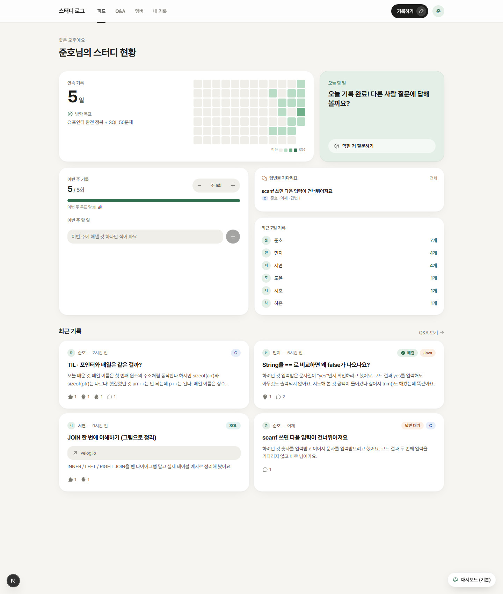

# 스터디 로그

> 함께 기록하고, 묻고, 답하는 방학 코딩 스터디 사이트



C, Java, SQL 등을 각자 공부하면서 **기록, 진도, 질문을 한 곳에 모으는** 10명 이하 소규모 스터디용 웹앱이에요.
가장 중요한 원칙은 **편의**예요.
- 버튼 하나로 로그인해요.
- 어디서든 바로 기록하고, 템플릿과 자동 임시저장을 지원해요.
- 이미 쓰는 블로그 링크도 기록으로 인정해요.

**스택**: Next.js 16 · React 19 · TypeScript · Tailwind CSS 4 · Supabase (Auth, Postgres, RLS)

## 문서
| 문서 | 내용 |
|---|---|
| [포트폴리오](study-hub/docs/portfolio.md) | 만든 이유, 기능, 기술적 고민, AI 도구 활용 |
| [개발 일지](study-hub/docs/devlog.md) | 세션별 작업과 트러블슈팅 |
| [결정 기록](study-hub/docs/decisions.md) | 무엇을 왜 그렇게 정했는지 |
| [로드맵](study-hub/docs/roadmap.md) | 완료한 일과 앞으로 할 일 |
| [설치·설정 방법](study-hub/README.md) | Supabase, OAuth, 실행, 배포 |

## 바로 실행해 보기 (Supabase 없이)
```bash
cd study-hub
npm install
cp .env.example .env.local   # DEMO_MODE=1 로 바꾸기
npm run dev
```
`DEMO_MODE=1`로 두면 샘플 데이터로 모든 화면을 볼 수 있어요. 개발 서버에서만 동작해요.
