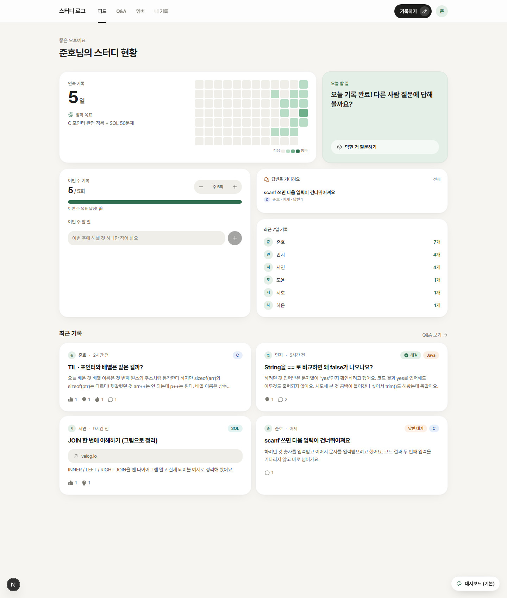

# 스터디 로그 — 방학 코딩 스터디 플랫폼

> 함께 기록하고, 묻고, 답하는 소규모 코딩 스터디 웹앱

## 한눈에 보기

| 항목 | 내용 |
|---|---|
| 기간 | 2026.11 ~ (진행 중) |
| 인원 | 1인 기획·디자인·개발 (AI 코딩 도구 활용) |
| 대상 | 기초가 부족한 사람을 포함해 코딩을 공부하려는 10명 이하의 스터디원 |
| 스택 | Next.js 16 (App Router, Cache Components) · React 19 · TypeScript · Tailwind CSS 4 · Supabase (Auth, Postgres, RLS) · Vercel |

## 왜 만들었나
방학 동안 C, Java, SQL 등을 **각자 공부하면서 꾸준히 공유하는** 스터디를 운영하려고 했어요.
- 블로그, 노션, 개인 필기처럼 기록 장소가 제각각이면 서로의 진도가 보이지 않아요.
- 단톡방 질문은 대화에 묻혀서 다시 찾을 수 없어요.

→ **기록, 진도, 질문을 한 곳에 모으되, 기록하는 수고는 최소로** 하는 것이 목표였어요.

## 핵심 원칙: 편의가 최우선
1. **가입 1초**: GitHub·Google 버튼 하나로 끝나고, 비밀번호는 없어요.
2. **어디서든 바로 기록**: 모든 화면에 기록 버튼이 있고, `Ctrl+Enter`로 올리며, 자동 임시저장과 복구를 지원해요.
3. **이미 쓰는 블로그를 그대로**: velog·티스토리·노션 링크만 붙여도 기록으로 인정돼요.
4. **빈칸 채우기 템플릿**: TIL, 개념 정리, 문제풀이, 주간 회고, 질문 템플릿이 있어서 기초가 부족해도 정리할 수 있어요.
5. **동기 부여**: 잔디 히트맵, 연속 기록일, 주간 기록 목표, 서로 보이는 이번 주 할 일

## 주요 기능
- **대시보드 홈**: 연속 기록과 12주 잔디, 오늘 할 일, 이번 주 목표, 답변 기다리는 질문, 멤버별 최근 7일 기록
- **목표**: 주 N회 기록 목표와 진행 막대, 주간 할 일 체크리스트, 못 끝낸 목표 이월
- **기록**: 마크다운 에디터 (코드 하이라이팅, 미리보기, Tab 들여쓰기, 템플릿)
- **Q&A**: 질문 템플릿, 답변 채택, 답변 대기·해결 필터
- **반응·댓글**: 좋아요, 배웠어요, 응원해요
- **테마 6종**: 사용자가 설정에서 선택해요 (기본: 세이지)

## 기술적으로 고민한 것

### 1. 보안: RLS로 "본인 것만" 지키기
- 모든 테이블에 행 단위 보안(RLS)을 켰어요. 읽기는 로그인 멤버 전체, 쓰기·수정·삭제는 본인 행만 허용해요.
- **답변 채택 문제**
  - 질문 작성자가 *남의 댓글*을 채택 상태로 바꿔야 해서 일반 정책으로는 불가능했어요.
  - 작성자 확인을 함수 안에서 하는 `accept_answer` RPC를 만들었어요.
  - 댓글 수정 권한은 `update (body)` **컬럼 단위**로 제한해서, 채택 여부를 직접 조작할 수 없게 했어요.
- Supabase의 2026-10 변경(새 테이블이 API에 자동 공개되지 않음)을 확인하고 `GRANT`를 명시했어요. 비로그인(anon) 사용자에게는 아무 권한도 주지 않았어요.

### 2. 성능과 사용자 경험: 스트리밍 렌더링
- Next.js 16의 Cache Components 환경에서 페이지마다 `Suspense`와 스켈레톤을 둬서, 화면 틀이 먼저 뜨고 데이터가 이어서 채워지게 했어요.
- 반응과 목표 체크는 `useOptimistic`으로 **누르는 즉시** 반영해요. 서버 응답은 나중에 맞춰요.

### 3. 디자인 시스템: 토큰 기반 테마와 레이아웃
- 색, 모서리, 그림자, 제목 폰트, 코드 색을 CSS 변수로 분리했어요. `data-theme` 하나로 6가지 테마가 바뀌어요.
- 레이아웃(틀)은 쿠키로 서버에 전달해서, 서버가 다른 HTML을 그려도 깜빡임이 없어요.
- 디자인을 고를 때는 **실제 데이터가 들어간 5가지 틀 × 6가지 색**을 직접 화면에서 비교했어요.

### 4. 개발 생산성: 데모 모드
- Supabase 쿼리 빌더 API를 흉내 내는 메모리 DB를 만들었어요. 백엔드 설정 없이도 모든 화면을 실제처럼 확인할 수 있어요.
- 디자인 탐색과 스크린샷 작업에 그대로 쓰였어요.

## AI 도구 활용
Claude Code와 에이전트 스킬을 이용해 개발했어요. 스킬은 **검색해서 고르고, 결과는 검증해서 채택하거나 버렸어요.**

| 단계 | 활용한 스킬 | 어떻게 썼나 |
|---|---|---|
| 기획 | `find-skills` | 스킬 생태계 검색. 설치 수와 출처를 보고 신뢰도를 검증해서 선별 |
| DB·보안 | `supabase`, `supabase-postgres-best-practices` | 최신 변경사항 확인, RLS·GRANT·인덱스 설계 |
| 디자인 방향 | `ui-ux-pro-max` | 접근성·터치 영역·아이콘 기준 적용. 추천된 아동용 폰트는 대상에 맞지 않아 **채택하지 않음** |
| 디자인 레퍼런스 | `awesome-design` | Notion, Claude, Linear의 디자인 토큰을 참고해 테마 제작 |
| 비주얼 | `taste-skill (soft-skill)` | 이중 테두리 카드, 떠 있는 메뉴, 부드러운 전환 |

## 화면
- 대시보드: 맨 위 이미지 (`screenshots/01-dashboard.png`)
- 글 상세, 글쓰기, Q&A, 모바일 화면: 배포 후 실제 화면으로 추가 예정

## 회고 (진행하면서 채워요)
- 잘한 점:
- 아쉬운 점:
- 배운 점:

## 관련 문서
- [개발 일지](devlog.md): 세션별 작업 기록
- [결정 기록](decisions.md): 왜 이렇게 만들었는지
- [로드맵](roadmap.md): 앞으로 할 일
